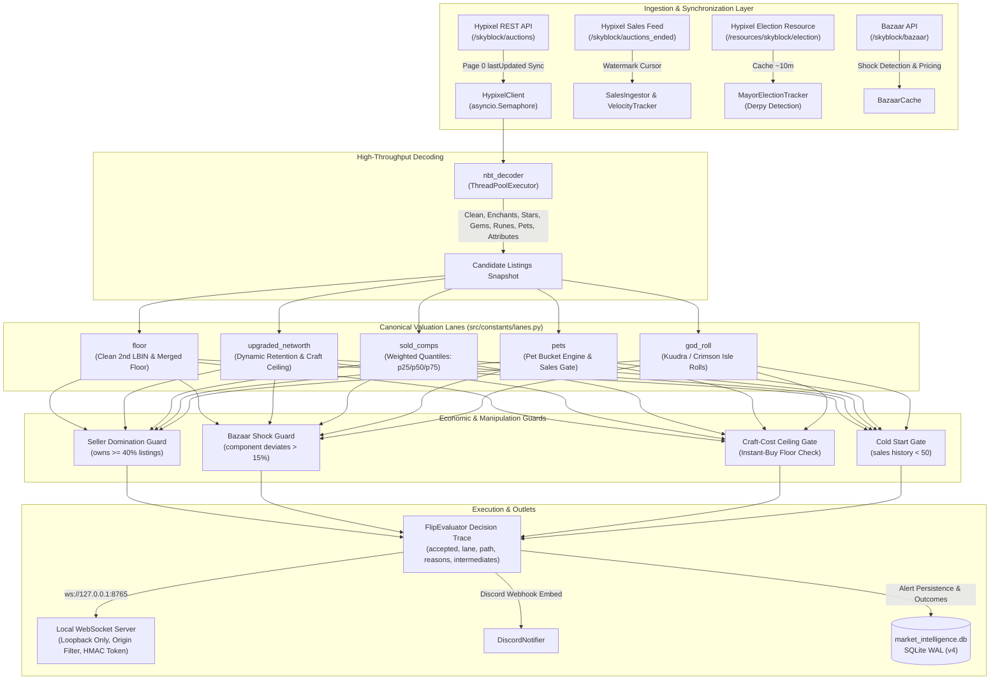

# Hypixel SkyBlock AH Arbitrage Engine & Sniper — Production Intelligence System

A high-performance, asynchronous algorithmic market ingestion and valuation engine with sub-second API clock synchronization, real-time Bazaar addon pricing, historical sold-comps evaluation, empirical Bayes dynamic retention, capital-efficiency ranking, automated portfolio PnL tracking, and local WebSocket client bridge for Hypixel SkyBlock.

> [!NOTE]
> This system is strictly an **observational data analysis and client-assist tool**. It never injects packets, automates purchasing, or manipulates in-game inventories. In-game interactions are client-side informational displays with native `/viewauction <uuid>` command execution.

---

## 1. System Architecture



---

## 2. Canonical Valuation Lanes

All market listings are routed into one of 5 canonical lanes defined in [`src/constants/lanes.py`](src/constants/lanes.py):

| Lane ID | Canonical Name | Methodology & Safeguards |
| :--- | :--- | :--- |
| `floor` | Clean Floor Arbitrage | Evaluates clean (unupgraded) items against the 2nd lowest BIN (`LBIN_2`) and clean floors. Identical-price sibling self-exclusion prevents artificial walls from triggering false flips. |
| `upgraded_networth` | Upgraded Item Networth | Calculates item replacement value using base LBIN plus Bazaar addon replacement costs (recomb, stars, gemstones, enchants) scaled by dynamic retention. Strictly capped by instant-buy crafting cost (`CRAFT_COST_CEILING`). |
| `sold_comps` | Historical Sold-Comps | Matches identical strict or relaxed feature hashes against completed sales in `sales_history`. Uses exponential time-decayed weighted quantiles ($p_{25}$ quick-sale valuation). Clamped within $\pm 25\%$ of networth. |
| `pets` | Pet Bucket Engine | Buckets pets strictly by `(type, rarity, level_bracket, held_item)`. Never compares across level brackets (`L1`, `L100`, `L200`). Enforces rarity sales gates (`PET_MIN_SALES_BY_RARITY`) and caps target at sold-comps $p_{25}$. |
| `god_roll` | Attribute Arbitrage | Evaluates Crimson Isle and Kuudra armor/weapons with high-tier attribute rolls (e.g. Mana Pool, Veteran, Magic Find) against historical sales and current attribute floors. |

---

## 3. Honest Confidence & Pricing Semantics

Alert confidence is computed with strict evidence standards (`src/ranking.py`):
- **`HIGH`**: Requires confidence score $\ge 75$ **AND** at least `MIN_COMPS_FOR_HIGH` ($\ge 5$) same-bucket empirical sales in the historical window. Additionally requires that profit at the quick-sale quantile ($p_{25}$) satisfies both `MIN_PROFIT_COINS` and `MIN_PROFIT_MARGIN_PCT`.
- **`MEDIUM`**: Standard confidence ($50 - 74$). Networth-only valuations (`upgraded_networth` without comps) and floor alerts during cold start are hard-capped at `MEDIUM`.
- **`LOW`**: Thinly traded items or tighter profit cushions ($< 50$).
- **Valuation Targets**:
  - **Quick-Sale Target ($p_{25}$)**: The conservative target used for all profit, margin, and confidence calculations.
  - **Optimistic Target ($p_{50}$)**: The empirical median displayed as a secondary metric.

---

## 4. Fee Model & Active Mayor Derpy Detection

Single source of truth in [`src/constants/taxes.py`](src/constants/taxes.py):
$$\text{Net Revenue} = \text{Price} - \text{Creation Fee} - \text{Collection Fee}$$

- **Creation Fee**:
  - $1.0\%$ flat for $\text{Price} < 10\text{M}$
  - $2.0\%$ flat for $10\text{M} \le \text{Price} < 100\text{M}$
  - $2.5\%$ flat for $\text{Price} \ge 100\text{M}$
- **Collection Fee**:
  - $1.0\%$ flat for $\text{Price} \ge 1,000,000$ (coins $\ge 1\text{M}$)
  - $0\%$ for $\text{Price} < 1,000,000$
  - Rises to `DERPY_COLLECTION_FEE_RATE` ($4.0\%$) whenever Mayor Derpy is elected.
- **Mayor Detection**:
  - Automatically polls Hypixel's election resource: `GET https://api.hypixel.net/v2/resources/skyblock/election` every 10 minutes (cached).
  - Can be manually overridden via `MAYOR_OVERRIDE=Derpy` in `.env`.
- **Best Resale Net Optimization**:
  - `best_resale_net(target)` checks listing at target vs boundary cliffs ($1\text{M}-1$, $10\text{M}-1$, $100\text{M}-1$) and returns optimal list price to avoid fee cliff penalties.

---

## 5. Configuration Cheatsheet (`.env`)

| Variable | Default | Description |
| :--- | :--- | :--- |
| `DISCORD_WEBHOOK_URL` | *Required* | Discord webhook URL for alerts |
| `DRY_RUN` | `false` | Run without dispatching webhooks |
| `MIN_PROFIT_COINS` | `1,000,000` | Minimum net profit in whole coins |
| `MIN_PROFIT_MARGIN_PCT` | `15.0` | Minimum net profit margin percentage |
| `DERPY_COLLECTION_FEE_RATE` | `0.04` | Collection fee rate when Mayor Derpy is active ($4\%$) |
| `MAYOR_OVERRIDE` | *None* | Override active mayor (`Derpy` or empty) |
| `QUICK_SALE_QUANTILE` | `0.25` | Valuation quantile for conservative targets ($p_{25}$) |
| `ENABLE_SOLD_COMPS` | `true` | Historical sold-comps valuation lane |
| `ENABLE_DYNAMIC_RETENTION`| `true` | Empirical Bayes dynamic retention |
| `ENABLE_BAZAAR_SHOCK_GUARD`| `true` | Rejects addon spikes/dumps ($> 15\%$) |
| `ENABLE_SELLER_DOMINATION_GUARD` | `true` | Rejects single-seller walls ($\ge 40\%$) |
| `MIN_COMPS_FOR_HIGH` | `5` | Minimum comps required for `HIGH` confidence |
| `COLD_START_MIN_SALES` | `50` | Minimum sales history before activating comps lanes |
| `SHADOW_MODE_LANES` | `""` | Comma-separated lanes evaluated and logged but never alerted |
| `ENABLE_OUTCOME_LABELING` | `true` | Automated post-snipe outcome labeling (`alert_outcomes`) |
| `ENABLE_LOCAL_WS` | `true` | Local WebSocket bridge for Minecraft Fabric client mod |
| `LOCAL_WS_HOST` | `127.0.0.1` | Loopback bind address (non-loopback refused) |
| `LOCAL_WS_PORT` | `8765` | WebSocket server port |
| `LOCAL_WS_TOKEN` | *None* | Optional HMAC token required during WebSocket handshake |
| `LOCAL_WS_ALLOWED_ORIGINS`| *None* | Comma-separated list of allowed browser origins |

---

## 6. CLI Tools & Operational Runbooks

### Historical Replay Backtester (`scripts/backtest.py`)
Simulate execution against historical sales with realistic reaction delay, capital constraints, and competing sniper decay:
```bash
# Replay all alerts with 1.5s reaction delay and 100M capital
python -m scripts.backtest --capital 100000000 --reaction-delay 1.5

# Replay specific lane with Derpy fee override
python -m scripts.backtest --lane floor --derpy --sample-size 500

# Replay specific date range
python -m scripts.backtest --start-date 2026-03-01 --end-date 2026-03-10
```

### Calibration & Outcome Reporting (`scripts/calibration_report.py`)
Generate calibration reports comparing predicted margins to realized market outcomes:
```bash
# Display terminal report
python scripts/calibration_report.py

# Export CSV report
python scripts/calibration_report.py --csv reports/calibration.csv
```

### Explaining Alert Decisions (`scripts/explain.py`)
Print full structured JSON decision trace for any historical alert:
```bash
# Inspect by Alert ID
python scripts/explain.py 42

# Inspect by Auction UUID
python scripts/explain.py 381fbc464161476db841f3e7fc71cfa0
```

### Player Portfolio Ledger (`scripts/ledger_cli.py`)
Inspect player flips and realized PnL:
```bash
python scripts/ledger_cli.py summary
python scripts/ledger_cli.py report
```

---

## 7. Running the System

```bash
# 1. Dry-run inspection cycle
python -m src.main --dry-run --once

# 2. Continuous dry-run mode
python -m src.main --dry-run

# 3. Live production mode
python -m src.main
```

---

## 8. Test Suite Verification

The engine is protected by **357 deterministic offline tests** with a 100% pass rate:
```bash
python -m pytest -v
```
Linting and formatting are checked with Ruff:
```bash
ruff check . && ruff format --check .
```
